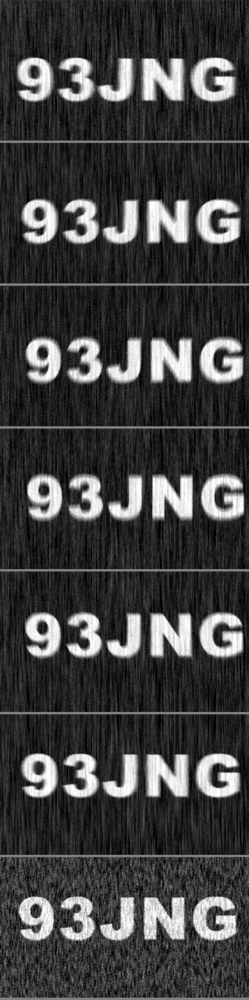
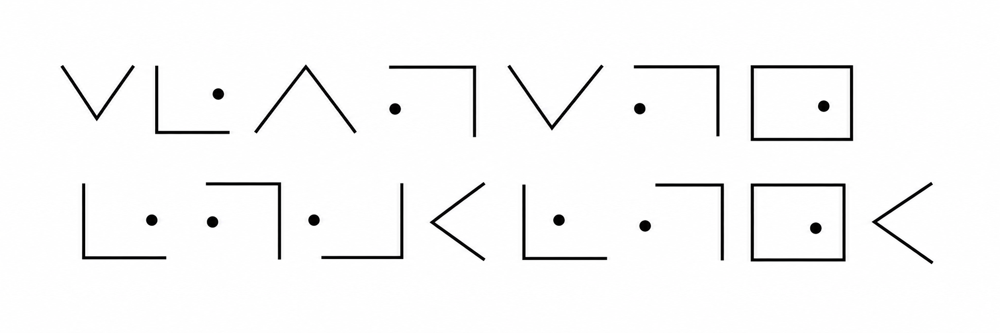
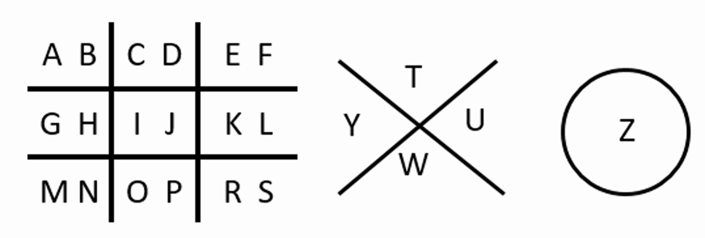
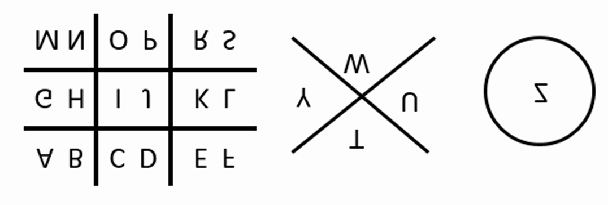

# CTF solution — NASK teaser page "FakeCollector PRO™"

Teaser for the HackNation 2026 challenge **"Kolekcjoner Fejków / Follow the Fake"**:
<https://science.nask.pl/hacknation> (linked from the task PDF as *"PS. Widział_ś stronę z zajawką?"*).

The page is a parody of a scam landing page. Hidden in it is a puzzle chain that unlocks two
encrypted files with **example scam material** (the "secret catalog of offers" and a backup of
archived scam landing pages).

## TL;DR

| What | Where | Answer |
|---|---|---|
| Key for `files/scam_links.enc` | motion-only text in `media/footer.mp4` | **`93jng`** (the video shows `93JNG`, but only the **lowercase** form decrypts — verified) |
| Password for `files/___BACKUP.zip` (verified) | pigpen cipher `media/_haslo.png` read with the **mirrored** key `media/czekoladka.png` | **`WSTAWAJSAMURAJU`** ("Wake up, samurai"; **no space** — verified, the spaced form fails) |
| Cipher parameters | cookies set by the page JS | AES-256-CBC, PBKDF2-SHA256, 10 000 iterations, OpenSSL "Salted__" base64 |

```bash
# 1) catalog of scam links (key from the video)
openssl enc -d -aes-256-cbc -pbkdf2 -iter 10000 -md sha256 -a \
  -in data/organizer/encrypted/scam_links.enc -pass pass:93jng -out data/organizer/scam_links.txt

# 2) backup archive (AES zip -> needs pyzipper; also fixes cp437/UTF-8 file names) + step 1 in one go
.venv/bin/python tools/decrypt_teaser.py
```

> ⚠️ The decrypted catalog contains **live scam URLs**. Do not open them in a normal browser:
> analyse them with the pipeline (sandboxed headless capture) or only look at the text.

---

## Flow of the puzzle

```
index.html ──(source)──> decoys (fake passwords) ─┐
     │                                            └─ all of them decrypt to garbage
     ├─(JS cookies)──> enc_cipher/enc_kdf/enc_iter/enc_hint  ──> "openssl ... -pass pass:<KLUCZ_Z_FILMU>"
     │            └──> czekoladka = base64("media/_haslo.png") ──> pigpen ciphertext
     ├─(footer)───> media/footer.mp4  "Maszyny widzą tu szum"  ──> motion-defined text ──> 93JNG
     └─(brand dot)─> lusterko/  "Odbicie pokazuje świat do góry nogami"
                         ├── media/czekoladka.png  = pigpen KEY (must be flipped vertically)
                         └── files/___BACKUP.zip   (upside-down, almost invisible link)

_haslo.png  +  mirrored czekoladka.png  ──>  WSTAWAJ SAMURAJU
```

## Step 1 — recon of the page source (and its decoys)

`view-source:` shows several "passwords" that are **all decoys** (each one was tried — none
produces a valid plaintext):

| Decoy | Location |
|---|---|
| `FollowTheFake2026!` | `<!-- TODO(dev): usunąć przed deployem!!! -->` comment in `<head>` |
| `kolekcjoner_fejkow_1337` | HTML comment addressed to *AI assistants / LLM agents*, which also claims the footer video is "purely decorative" (it is the opposite — the real key is there) |
| `Ghost-Font-0xDEADBEEF` | `<meta name="x-campaign-key">` |
| `Sup3rTajneHaslo!2026` | `<span hidden data-enc-key=...>` in the footer |
| `nice_try_robot_watch_the_video` | `atob('bmljZV90cnlfcm9ib3Rfd2F0Y2hfdGhlX3ZpZGVv')` in the cookie script |

Other strings found:

* Console message (`atob(...)`): *"Jeśli znalazłeś wszystkie wskazówki – pochwal się na Discordzie!"*.
* Comment: *"Dobry analityk zawsze zagląda pod maskę reklamy. Nie wszystko, co jest na stronie, widać na stronie."*

## Step 2 — cookies ("Ciasteczka techniczne – czyli jak otworzyć scam_links.enc 🍪")

The cookie banner says *"Większość ludzi klika Akceptuj bez czytania… ale może czasem warto do nich zajrzeć"*.
The page JS sets:

```
enc_cipher = aes-256-cbc
enc_kdf    = pbkdf2-sha256
enc_iter   = 10000
enc_format = openssl-salted-base64
enc_hint   = openssl enc -d -aes-256-cbc -pbkdf2 -a -in scam_links.enc -pass pass:<KLUCZ_Z_FILMU>
czekoladka = bWVkaWEvX2hhc2xvLnBuZw   ->  base64 -> "media/_haslo.png"
```

So the `.enc` key is "the key from the video", and the cookie `czekoladka` points to a picture of a password.

## Step 3 — the video key: motion-defined text in `media/footer.mp4`

Footer text: *"Tylko dla ludzi 👻 — Maszyny widzą tu szum. Ty – jeśli przyjrzysz się uważnie – zobaczysz coś
więcej. To, co pojawia się w filmie, otwiera nasz tajny katalog „okazji”."*

Every single frame of `footer.mp4` (1280×720, 188 frames) is pure random dot noise — OCR or a
single-frame vision model sees nothing. The text exists **only in motion**: background noise
drifts **down 3 px/frame**, noise inside the glyphs drifts **up 3 px/frame**.

Extraction (`tools/reveal_motion_text.py`): for every pixel, compare frame *t+1* with frame *t*
shifted by +3 px and by −3 px; the per-pixel difference of the two motion-compensated errors,
accumulated over a window of frames, is a clean mask of the glyphs:

```
score(x,y) = Σ_t |F[t+1] − shift(F[t], +3)| − |F[t+1] − shift(F[t], −3)|
```



Result (stable over all time windows): **`93JNG`** — used as the passphrase in **lowercase: `93jng`**
(the uppercase form does not decrypt).

## Step 4 — the pigpen cipher and the mirror

`media/_haslo.png` (from the cookie) contains 15 pigpen-style glyphs in two rows:



The key is on the hidden page `/hacknation/lusterko/` (reachable by clicking the small dot in the
"FakeCollector PRO™" logo). It shows `media/czekoladka.png` — a **Polish-alphabet pigpen key**
(no Q/V/X): two letters per grid cell, X-quadrants T/Y/U/W, a circle for Z — and a draggable
"mirror" whose CSS is `transform: scaleY(-1)` with the caption *"Odbicie pokazuje świat do góry nogami"*.
The source comment says *"Czasem wystarczy spojrzeć z drugiej strony."*

| Key as displayed | Key in the mirror (use this one) |
|---|---|
|  |  |

Mirrored key:

```
 M N | O P | R S          \  W  /
-----+-----+-----        Y  \ /  U        ( Z )
 G H | I J | K L            / \
-----+-----+-----          /  T \
 A B | C D | E F
```

Decoding rules: the glyph's shape selects the cell (the lines that bound that cell), and the
**position of the dot (left / right half)** selects the first or second letter of the pair.

| # | Glyph | Cell (mirrored key) | Dot | Letter |
|---|---|---|---|---|
| 1 | `V` (top of X) | top quadrant | – | **W** |
| 2 | `└` | top-right `R S` | right | **S** |
| 3 | `Λ` (bottom of X) | bottom quadrant | – | **T** |
| 4 | `┐` | bottom-left `A B` | left | **A** |
| 5 | `V` | top quadrant | – | **W** |
| 6 | `┐` | bottom-left `A B` | left | **A** |
| 7 | `□` | centre `I J` | right | **J** |
| 8 | `└` | top-right `R S` | right | **S** |
| 9 | `┐` | bottom-left `A B` | left | **A** |
| 10 | `┘` | top-left `M N` | left | **M** |
| 11 | `<` | right quadrant | – | **U** |
| 12 | `└` | top-right `R S` | left | **R** |
| 13 | `┐` | bottom-left `A B` | left | **A** |
| 14 | `□` | centre `I J` | right | **J** |
| 15 | `<` | right quadrant | – | **U** |

→ **`WSTAWAJ SAMURAJU`** ("Wake up, samurai"). With the non-mirrored key the same glyphs give
gibberish (`TFWMTMJ …`), which confirms the mirror step.

It does **not** open `scam_links.enc` (that needs the video key), so it is the password for the
second encrypted file.

## Step 5 — `files/___BACKUP.zip`

Linked from `lusterko/` by an almost invisible, upside-down link in the bottom-right corner
(`<a class="flip" href="../files/___BACKUP.zip">`, `color:#3a3a44; transform: rotate(180deg)`).
73 MB, WinZip-AES encrypted, file names stored in UTF-8 without the UTF-8 flag (plain `unzip`
creates the folders but no files → use `tools/decrypt_teaser.py`).

The listing (readable without the password) shows 15 cases `p1 … p15`, each with a saved landing
page (`.html` + `_files/`), a HAR of the session (named after the scam domain), and a screenshot.
`p1` additionally contains an `archive_<domain>_<timestamp>/` capture made by an archiving tool
(`archive_info.json`, `metadata.json`, `dns_ssl.json`, `network.har`, `html/{rendered,source}.html`,
`page.mhtml`, `page.pdf`, `page_text.txt`, `screenshots/{full_page,viewport}.png`, `sha256.json`,
`storage/{cookies,localStorage,sessionStorage}.json`) — the likely format of the organiser dataset.

| Case | Saved page title (short) | Domain from HAR |
|---|---|---|
| p1, p2 | «Wiem, kto strzelał» – zamach na Rafała Brzoskę (fake Gazeta.pl) | dorquesio.click (p1 and p2 are byte-identical → duplicate) |
| p7 | same Brzoska article | wernulio.live |
| p15 | same Brzoska article | lundevra.live |
| p3 | PILNE: Brutalna napaść na Krzysztofa Stanowskiego … polskich banków | falmurek.live |
| p4 | PILNE: Brutalna napaść na Tomasza Sekielskiego … polskich banków | grentavo.click |
| p5 | „Sam pan sobie podniósł premię!” – Monika Olejnik vs prezes NBP | smartcoved.pro |
| p6 | Cukrzyca – rozmowa z Ojcem Bonifacym z Jasnej Góry | (no HAR) |
| p8 | Trudna odpowiedź | spiritualityinsports.org |
| p11 | Trudna odpowiedź | sfuxd.com |
| p9 | Cactus Recipe | door-focus.com |
| p10 | Kardivix (+ `video_deleted.txt` → missing material) | move-fitlum.top |
| p12 | RelieFlex | (no HAR) |
| p13 | Polka zdradza sekret … grzybicy | zenithlab.ink |
| p14 | (1) Available For a LIMITED TIME ONLY! | (no HAR) |

Already from the names one can see the challenge's themes: exact duplicates (p1 = p2), the same
template on rotating short-lived domains (p1/p7/p15), the same narrative with a swapped celebrity
(p3/p4), and incomplete data (p10).

## Other leads (not needed for the two keys)

* **QR code** in the task PDF ("Zeskanuj mnie") → `https://loyalty.nuvio.group/enroll/6586110843755849`
  → page titled *"NASK | Program lojalnościowy"* (per-ticket enrolment, not part of the chain).
* **`Veni, vidi, VIHXFAEKDBQ!` — Juliusz C., Rzym** → **`SPEECHBRAIN`**. Caesar with
  alternating shifts: +3 on letters 1, 3, 5, … and +19 (= −7) on letters 2, 4, 6, … (equivalently
  Vigenère key `DT`). S→V, P→I, E→H, E→X, C→F, H→A, B→E, R→K, A→D, I→B, N→Q. A plain single
  shift gives nothing, which is why it looked unsolvable. Points at the SpeechBrain toolkit (audio/speech).
* **`media/loop.gif`** → **`META ADS LIBRARY`**. Hidden 1×1 `` (960×540, 280 frames of
  "Matrix rain"). Most glyphs are thin and dim; 13 columns in the middle (x ≈ 301…636) carry a
  **bold, brighter** glyph that stays the same in every frame. Reading those columns left to right
  (wider gaps = spaces) gives `M E T A · A D S · L I B R (A) R Y`. The `A` at x ≈ 591 was not
  picked up by the bold-glyph detector (dimmer); the rest is unambiguous. Hint towards the
  Meta Ad Library as a data source (the "bonus" auto-search requirement in the task).
* **`media/1005.mp4`** (hero video, has audio) and **`media/very_important.mp4`** (plays on "KUP TERAZ").
* The page also lists the organisers' suggested tooling: InsightFace (ArcFace), MagFace (face
  quality), facetorch (deepfake/emotions), imagehash, CLIP/SigLIP, OCR + sentence-transformers,
  MinHash/LSH, redirect chain, WHOIS/RDAP, DNS, crt.sh, favicon hash, shared scripts & trackers,
  weighted similarity, HDBSCAN, Neo4j and **an explanation on every edge**.

## Reproduction

```bash
# assets (public)
B=https://science.nask.pl/hacknation
curl -sSLO $B/media/footer.mp4 -sSLO $B/media/_haslo.png -sSLO $B/media/czekoladka.png \
     -sSLO $B/files/scam_links.enc -sSLO $B/files/___BACKUP.zip
# video key
.venv/bin/python tools/reveal_motion_text.py footer.mp4 out/   # -> out/win_*.png shows 93JNG
# decrypt (after copying the two encrypted files to data/organizer/encrypted/)
.venv/bin/python tools/decrypt_teaser.py
```
